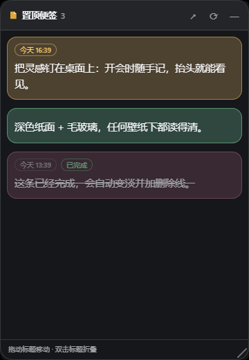

# DSH Sticky Notes · 便签墙

A sticky-note wall for DeepSeek Harness (DSH) Web and Desktop: a sidebar entry, a masonry wall of notes, pasted images and text, due reminders, done state, keyboard shortcuts, a pin-on-top floating window, appearance skins, and an optional **native always-on-top Windows desktop window**.

[中文说明](README.zh.md)

## Features

- **Sidebar entry** — a sticky-note icon in the left rail with an overdue badge; it opens the wall in the main column.
- **Pinned notes** — pin any note with the pushpin or the editor toggle. Pinned notes appear in a **floating window that floats above every Harness panel** and survives panel switches. Drag the title bar to move it (positions snap to the screen edges), collapse it, or hide it.
- **Floating quick capture** — the floating window has its own capture box: type, `Ctrl/Cmd+Enter`, and the new note is pinned immediately. Pinned cards support inline editing, done toggles, due chips and image thumbnails.
- **Desktop window (Windows)** — open a **native always-on-top window** that renders the pinned notes outside Harness, above other applications. The helper is compiled from the shipped C# source on first use (about ten seconds) and runs on the Microsoft Edge WebView2 runtime that Windows 10/11 already ships.


- **Images and text** — paste screenshots with `Ctrl/Cmd+V`, drop files, or pick images in the wall, the editor and the floating window. Images are stored under the plugin data directory and referenced by file name.
- **Due reminders** — set a due time per note; overdue notes raise an in-app reminder with *View / Done / Snooze 10 min*, an optional desktop notification, a sidebar badge, and a "Due today" filter.
- **Done state** — tick a note to complete it; completed notes fade, gain a line-through and move to the Done filter.
- **Appearance** — pick the note colour scheme (follow theme / light paper / dark paper), paper surface (auto / solid / frosted glass), contrast, default colour, font family, text size, line height, corner radius and density. Notes choose their own paper colour, so they stay readable on light themes, dark themes and wallpaper backgrounds alike.
- **Manual order** — switch the wall to *Manual* and drag cards to reorder them; the order is persisted per note.
- **Login start** — optionally register Harness in `HKCU\Software\Microsoft\Windows\CurrentVersion\Run` so the notes are available right after sign-in.
- **Keyboard shortcuts**

| Shortcut | Action |
| --- | --- |
| `Ctrl/Cmd + Shift + N` | Open the wall and start a new note from anywhere |
| `Ctrl/Cmd + Shift + P` | Show or hide the floating window |
| `N` | New note inside the wall |
| `Ctrl/Cmd + Enter` | Save (editor, quick capture, inline float edit) |
| `/` | Focus search |
| `?` | Shortcut sheet |
| `Esc` | Close the editor, cancel an inline edit, or close the image preview |

## Install

From the marketplace listing (recommended):

```bash
dsh plugin --profile web add github:skyline66/dsh-sticky-notes-wall
```

From a local checkout while developing:

```jsonc
// profile package.json
"dsh-sticky-notes-wall": "link:C:/Users/you/plugins/dsh-plugins/sticky-notes"
```

then refresh the page. The sidebar icon appears in the left rail; the plugin also adds a **Sticky Notes** page under Settings.

After updating the host half (`index.js`), restart Harness once so the new JavaScript generation loads; the browser half reloads through the client bundle watcher.

## Settings

`Settings → Sticky Notes` collects every appearance and desktop option:

- **Appearance** — colours, paper surface, contrast, default colour, font, text size, line height, radius, density, live preview.
- **Floating window** — width, opacity, position lock, open on start, show/hide.
- **Desktop & order** — native desktop window, login start, note ordering.

## Desktop window details

- Windows only. Requires the .NET Framework compiler (`csc.exe`, included in Windows 10/11) and the WebView2 runtime.
- Compiled on first use into the plugin data directory; the package ships source only.
- The window is draggable by its title bar, collapsible by double-clicking it, resizable from the bottom-right grip, and remembers its bounds.
- Clicking any note focuses the Harness window; the tray icon offers *Show / Reload / Quit*; the window closes itself when Harness exits.

## Data

```
~/.dsh/sticky-notes/
  wall.json            notes, done state and reminder stamps
  prefs.json           appearance, floating window and ordering preferences
  attachments/         pasted images
  desktop/             compiled desktop helper, widget files, payload
  desktop-data/        desktop window bounds, WebView2 profile, native.log
```

The floating window's own visibility, position and pin list are browser UI state in `localStorage`; appearance preferences are cached there as well and mirrored to `prefs.json`.

## Tests

```bash
npm test              # CSS, host API + preference clamping, client registrations, encoding
npm run test:desktop  # compiles and launches the native window, then stops it (Windows)
```

## Layout

```
index.js              Host half: note store, prefs, autostart, desktop helper, /sticky-notes/api/*
client.js             Client half: sidebar entry, wall panel, floating window, settings section
native/StickyWidget.cs   always-on-top WebView2 window
native/widget/           the desktop window's HTML/CSS/JS
native/sdk/              WebView2 SDK DLLs (Microsoft, see LICENSE.txt / NOTICE.txt)
```

## License

MIT for this plugin. The bundled WebView2 SDK binaries are Microsoft's, redistributed under their license in `native/sdk/LICENSE.txt` and `native/sdk/NOTICE.txt`.